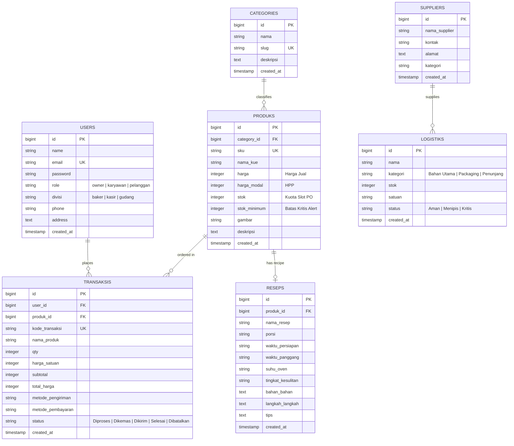

# By.Reesha - Handcrafted Bakery & Pre-Order Management System
> **Proyek Ujian Tengah Semester (UTS) Terintegrasi - Pemrograman Web 2**  
> Sistem Informasi Manajemen Toko Roti & Pemesanan Kue Berbasis Pre-Order (PO) dengan Konsistensi Stok Atomik, Role-Based Access Control, dan Pelaporan Eksekutif.

---

## 📋 Daftar Isi
1. [Tentang Proyek](#-tentang-proyek)
2. [Fitur Utama & Rubrik Penilaian](#-fitur-utama--rubrik-penilaian)
3. [Arsitektur Sistem & Tech Stack](#-arsitektur-sistem--tech-stack)
4. [Diagram ERD & Relasi Database](#-diagram-erd--relasi-database)
5. [Akun Pengujian Demo (Credentials)](#-akun-pengujian-demo-credentials)
6. [Panduan Instalasi & Setup Lokal](#-panduan-instalasi--setup-lokal)
7. [Penjelasan Business Logic Utama](#-penjelasan-business-logic-utama)
8. [Panduan Tanya Jawab Ujian (Oral Defense Cheatsheet)](#-panduan-tanya-jawab-ujian-oral-defense-cheatsheet)

---

## 🎂 Tentang Proyek
**By.Reesha** adalah platform web toko roti kustom (*artisan bakery*) yang beroperasi di Kota Lhokseumawe, Aceh. Toko ini memproduksi kue segar berdasarkan pesanan (**Pre-Order H-2 / H-3**).

Dalam implementasi akademik ini, seluruh rubrik UTS Pemrograman Web 2 dipenuhi secara komprehensif tanpa menghilangkan identitas bisnis aslinya:
- **Inventaris & Stok Produk**: Diformulasikan sebagai **Kuota Slot Produksi Baking per Batch**. Setiap varian kue memiliki batas kuota harian/batch (`stok`), batas aman kritis (`stok_minimum`), serta kode SKU unik (`BR-MINI-01`, `BR-BENTO-02`, dst.).
- **Konsistensi Transaksi**: Transaksi pemesanan memotong kuota slot baking secara atomik menggunakan database transaction (`DB::transaction`) dan *row-level locking* (`lockForUpdate()`), mencegah *race condition* dan *overselling*.
- **Restorasi Stok**: Pembatalan transaksi oleh staf maupun pelanggan otomatis mengembalikan kuota slot baking kembali ke sistem.

---

## ✨ Fitur Utama & Rubrik Penilaian

| Modul / Kriteria UTS | Fitur yang Diimplementasikan | Lokasi Kode / File |
| :--- | :--- | :--- |
| **Master Data (25%)** | Manajemen Produk kue, Kategori (`categories`), Logistik/Bahan baku, Supplier, dan Akun Staf. | `app/Models/Produk.php`, `Category.php`, `routes/web.php` |
| **Konsistensi Stok (20%)** | Validasi stok server-side, pengurangan stok otomatis, restorasi stok saat pembatalan, pencegahan transaksi saat kuota habis. | `routes/web.php` (`/checkout/proses`, `/pemesanan/{id}/update-status`, `/riwayat-transaksi/{id}/batal`) |
| **Database & Eloquent (15%)** | Migrasi database terstruktur, foreign keys, relasi `belongsTo`, `hasMany`, query scopes (`scopeLowStock()`), dan seeder data awal lengkap. | `database/migrations/`, `database/seeders/DatabaseSeeder.php` |
| **Arsitektur & Validasi (15%)** | Kalkulasi subtotal, ongkir, biaya layanan di controller server (bukan percaya input form), validasi CSRF, dan sanitasi input. | `app/Http/Controllers/ProdukController.php`, `routes/web.php` |
| **Hak Akses & Auth (10%)** | 3 Tingkat Role: **Owner**, **Karyawan (Baker/Staf Gudang)**, dan **Pelanggan**. Ditegakkan ketat di server-side middleware. | `routes/web.php`, `app/Models/User.php` |
| **Dashboard & UI (5%)** | Metric cards (Omzet Bruto, Pesanan, Pelanggan, Low-Stock Alert), grafik tren omzet 7 hari, filter periode laporan, search, dan badge kuota PO. | `resources/views/dashboard_owner.blade.php`, `katalog.blade.php` |
| **Keamanan & Restock (5%)** | Proteksi SQL Injection via Eloquent, CSRF protection, password hashing (`bcrypt`), row locking, modul restock kuota batch kue & bahan baku. | `resources/views/logistik.blade.php`, `routes/web.php` |
| **Dokumentasi (5%)** | Dokumentasi README lengkap, ERD diagram, panduan instalasi, dan panduan ujian lisan. | `README.md` |

---

## 🛠 Arsitektur Sistem & Tech Stack
- **Framework**: Laravel 10 / 12 (PHP 8.2+)
- **Database**: PostgreSQL (Supabase Production / Vercel Serverless) & MySQL / SQLite Compatible
- **Frontend / Styling**: Tailwind CSS, Google Fonts (Plus Jakarta Sans & Poppins), Blade Templating
- **Iconography**: Clean SVG Vector Icons
- **Deployment Platform**: Vercel Serverless Platform

---

## 🗄 Diagram ERD & Relasi Database



---

## 🔑 Akun Pengujian Demo (Credentials)

Sistem telah dilengkapi dengan Database Seeder yang menyediakan 3 akun pengujian siap pakai untuk seluruh role:

| Role | Email Login | Password | Hak Akses Utama |
| :--- | :--- | :--- | :--- |
| **Owner (Pemilik Toko)** | `byreeshaowner@gmail.com` | `password123` | Akses penuh: Dashboard Finansial, Laporan Omzet, Manajemen Karyawan, Logistik, Supplier, Pesanan, Resep |
| **Karyawan (Baker / Staff Dapur)** | `baker@byreesha.com` | `password123` | Manajemen Pemesanan (update status dapur), Logistik & Restock Batch, Standarisasi Resep Dapur *(Dilarang akses Laporan Finansial & Dashboard Owner)* |
| **Pelanggan (Customer)** | `pelanggan@byreesha.com` | `password123` | Katalog Kue, Pencarian & Filter Kategori, Keranjang, Checkout, Riwayat Belanja & Pembatalan Pesanan *(Dilarang akses Konsol Admin/Karyawan)* |

---

## 🚀 Panduan Instalasi & Setup Lokal

Ikuti langkah-langkah berikut untuk menjalankan proyek pada komputer lokal:

### 1. Prasyarat Sistem
- PHP >= 8.2 (dengan ekstensi `pdo`, `pdo_pgsql` atau `pdo_mysql`, `mbstring`, `openssl`)
- Composer >= 2.x
- Git

### 2. Clone Repository
```bash
git clone https://github.com/mhmdfauzan/by_reesha_laravel.git
cd by_reesha_laravel
```

### 3. Install Dependensi Composer
```bash
composer install
```

### 4. Konfigurasi Environment (`.env`)
Salin file konfigurasi contoh:
```bash
cp .env.example .env
```
Sesuaikan konfigurasi database pada `.env` (misalnya menggunakan MySQL lokal atau PostgreSQL):
```env
DB_CONNECTION=mysql
DB_HOST=127.0.0.1
DB_PORT=3306
DB_DATABASE=by_reesha_db
DB_USERNAME=root
DB_PASSWORD=
```
*(Atau gunakan koneksi PostgreSQL Supabase yang telah disediakan)*

Generate Application Key:
```bash
php artisan key:generate
```

### 5. Jalankan Migrasi & Database Seeder
Jalankan migrasi database beserta data dummy resmi:
```bash
php artisan migrate --seed
```
*Perintah ini akan membuat seluruh tabel, 4 master kategori, 8 varian produk ber-SKU, supplier lokal Lhokseumawe, stok logistik, dan 3 akun pengguna demo.*

### 6. Jalankan Server Lokal
```bash
php artisan serve
```
Buka peramban (browser) di: `http://127.0.0.1:8000`

---

## 💡 Penjelasan Business Logic Utama

### 1. Konsistensi Stok & Atomic Transaction (`DB::transaction`)
Pemesanan kue bukan sekadar `INSERT` data. Di dalam route `/checkout/proses`, alur diproteksi oleh blok transaksi atomik:
```php
DB::transaction(function () use ($request) {
    // 1. Lock record produk untuk mencegah dua user membeli kuota slot terakhir bersamaan
    $produk = Produk::lockForUpdate()->findOrFail($request->input('produk_id'));

    // 2. Validasi stok/kuota PO
    if ($produk->stok < $qty) {
        throw new \Exception("Mohon maaf, kuota slot PO untuk {$produk->nama_kue} tidak mencukupi.");
    }

    // 3. Potong kuota slot secara atomik
    $produk->decrement('stok', $qty);

    // 4. Hitung harga di sisi server
    $subtotal   = $produk->harga * $qty;
    $totalHarga = $subtotal + $ongkir + $biayaLayanan;

    // 5. Buat record transaksi penjualan
    return Transaksi::create([...]);
});
```
Jika terjadi kegagalan sistem atau server terputus di tengah proses, seluruh perubahan database di-**rollback** otomatis, memastikan stok tidak pernah berkurang tanpa adanya rekaman transaksi.

### 2. Restorasi Kuota Slot Saat Pembatalan
Jika status pesanan diubah menjadi `Dibatalkan` atau `Batal` (baik oleh kasir/owner di halaman `/pemesanan` maupun oleh pelanggan di halaman `/riwayat-transaksi`), kuota slot dikembalikan secara otomatis:
```php
$trx->produk->increment('stok', $trx->qty);
```

### 3. Peringatan Stok Kritis (Low-Stock Alert)
Model `Produk` memiliki query scope khusus:
```php
public function scopeLowStock($query)
{
    return $query->whereColumn('stok', '<=', 'stok_minimum');
}
```
Ketika kuota slot tersisa $\le 3$, sistem akan:
- Menampilkan card metric peringatan merah/kuning di Dashboard Owner.
- Menampilkan alert banner interaktif yang mempermudah restock batch.
- Menampilkan badge *"Sisa X Slot PO"* beranimasi di katalog dan halaman detail produk.

---

## 🎓 Panduan Tanya Jawab Ujian (Oral Defense Cheatsheet)

Berikut adalah panduan jawaban resmi saat sesi wawancara / ujian kode bersama dosen penguji (berdasarkan **Slide 24 Presentasi UTS**):

### Q1: "Jelaskan alur transaksi penjualan dari controller hingga update stok!"
> **Jawaban:**  
> "Saat pelanggan mengklik tombol checkout, request dikirim ke `POST /checkout/proses`. Pertama, server memvalidasi input form menggunakan Form Validation. Selanjutnya, proses dibungkus dalam `DB::transaction()` dengan `Produk::lockForUpdate()`. Server memverifikasi ketersediaan kuota slot (`$produk->stok >= $qty`). Jika valid, kuota didekremen menggunakan `$produk->decrement('stok', $qty)`. Kemudian server menghitung subtotal (`$produk->harga * $qty`) serta ongkir berdasarkan metode pengiriman yang dipilih, lalu menyimpan data ke tabel `transaksis` dengan kode transaksi unik `TRX-YYYYMMDD-XXXX`. Jika semua langkah sukses, transaksi di-commit; jika gagal, di-rollback utuh."

### Q2: "Bagaimana aplikasi menangani concurrency / race condition saat dua user membeli produk yang sama?"
> **Jawaban:**  
> "Kami menerapkan mekanisme **Pessimistic Locking** menggunakan `Produk::lockForUpdate()`. Saat Request A membaca row produk di database dalam sebuah `DB::transaction()`, database mengunci (*lock*) baris tersebut. Jika Request B mencoba mengakses produk yang sama pada milidetik yang bersamaan, Request B harus menunggu hingga transaksi Request A selesai (commit/rollback). Hal ini mencegah fenomena *overselling* di mana dua user melihat stok 1 lalu sama-sama berhasil membeli."

### Q3: "Kenapa harga total dihitung di server, bukan mengambil dari input form?"
> **Jawaban:**  
> "Karena input dari browser/klien tidak pernah boleh dipercaya (**Never Trust Client Input**). Pengguna teknis dapat dengan mudah memodifikasi elemen HTML form menggunakan browser Developer Tools (Inspect Element) untuk mengubah `<input name="total_harga" value="1000">`. Oleh karena itu, di `routes/web.php`, harga satuan diambil langsung dari database (`$produk->harga`), lalu dikalikan dengan kuantitas dan ditambahkan ongkos kirim standar yang dihitung otoritatif oleh server."

### Q4: "Bagaimana arsitektur hak akses (Owner, Karyawan, Pelanggan) ditegakkan di backend?"
> **Jawaban:**  
> "Hak akses ditegakkan di level route middleware dan server validation menggunakan kolom `role` pada model `User`. Jika seorang pelanggan mencoba mengakses `/dashboard-owner` atau `/karyawan`, server langsung mengintersep dan me-redirect mereka ke `/riwayat-transaksi` atau membatalkan request dengan kode `403 Forbidden`. Demikian pula karyawan (baker) yang hanya diizinkan membuka `/pemesanan`, `/logistik`, dan `/resep` tidak dapat mengakses laporan finansial omzet owner."

### Q5: "Bagaimana database transaction (`DB::transaction`) menjaga konsistensi jika terjadi crash?"
> **Jawaban:**  
> "Fitur `DB::transaction()` memanfaatkan sifat **ACID (Atomicity, Consistency, Isolation, Durability)** database relation (PostgreSQL/MySQL). Seluruh operasi di dalam closure dianggap sebagai satu kesatuan unit kerja (*All or Nothing*). Jika query create transaksi gagal atau server mengalami crash sebelum commit, database rollback seluruh perubahan, sehingga stok tidak akan terpotong secara menggantung tanpa adanya bukti transaksi."

---

## 👥 Pengembang / Mahasiswa
- **Nama Toko**: By.Reesha Artisan Cake & Bakery
- **Lokasi**: Kota Lhokseumawe, Aceh
- **Mata Kuliah**: Pemrograman Web 2 (Integrated Laravel Project)
- **Tahun**: 2026
